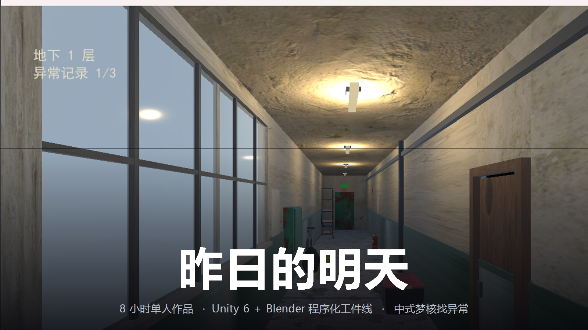
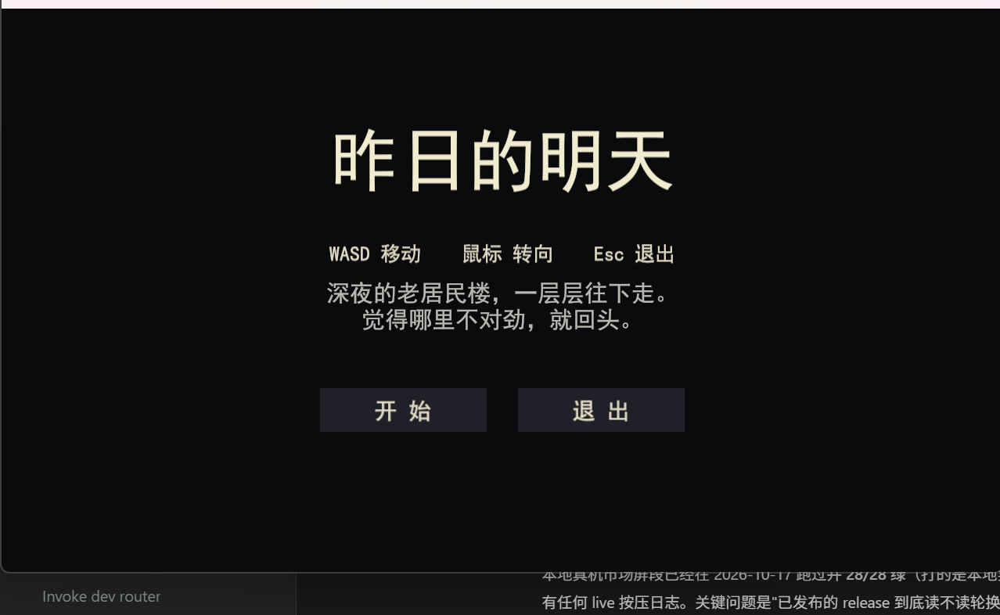
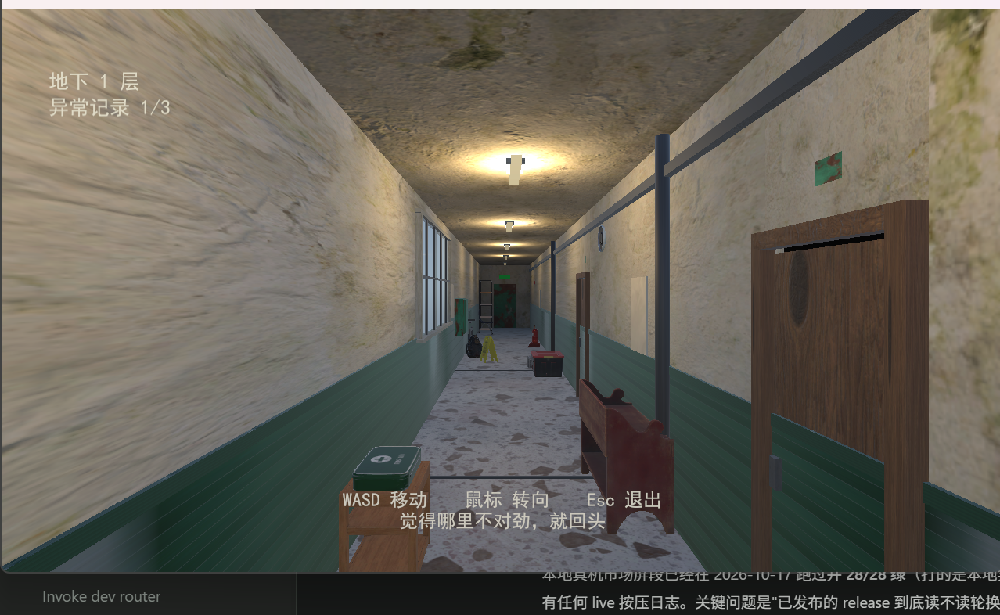
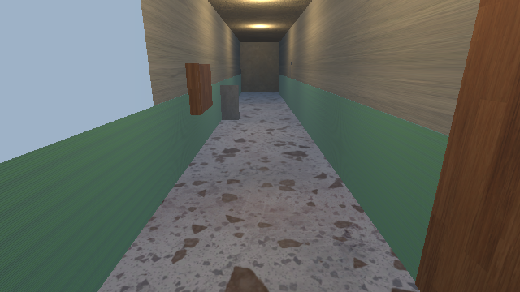
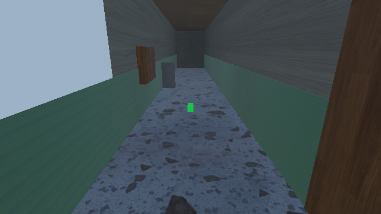
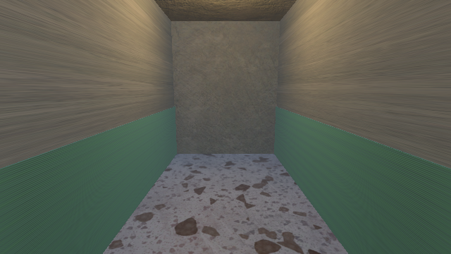
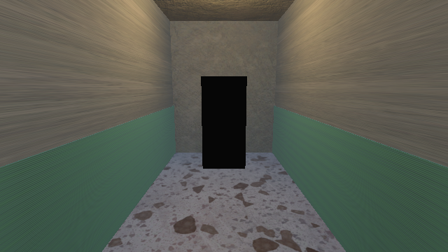
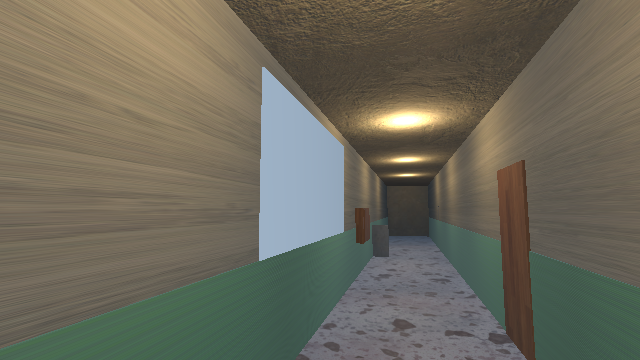
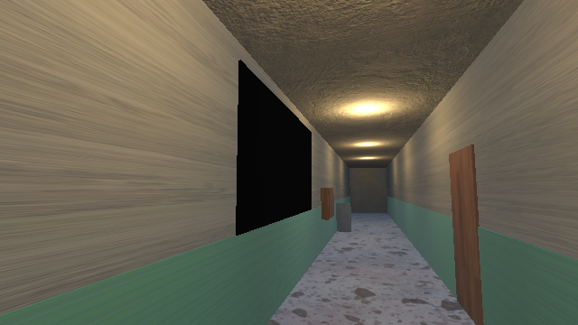

# 昨日的明天 · Dreamcore



> **8 小时单人 gamejam 作品。中式梦核找异常：你在深夜的老居民楼里一层层往下走，觉得哪里不对劲，就回头。**

内核：*昨日想象中的明天已经过期*。场景取千禧年前后中国城镇的居民楼公共走廊——水磨石地面、绿漆墙裙、声控灯、信报箱、防盗门、开锁疏通的小广告。这些空间在 2000 年前后是"明天"，今天回头看，那个明天从来没有来过。

- 引擎：**Unity 6.3 LTS + URP 17.0.1**（零新增包）
- 美术管线：**Blender 5.2.2 + Python 程序化建模**，headless 导出 FBX
- 平台：Windows x64（DirectX 12 / Mono）
- 时长：一局 3–5 分钟 · 8 层 · 10 组异常 · 2 种结局
- AI 辅助开发：允许并已使用（代码、着色器、工装脚本、取证自动化）

---

## 玩

**下载 → 解压 → 双击 `Dreamcore.exe`**（不是双击 zip 里的 exe，要先完整解压）。

| | |
|---|---|
| 开局 | 标题页点「开 始」，或直接按 `Enter` / `Space` |
| 移动 | `W` `A` `S` `D`（慢走节奏，梦核感：游荡而不是奔跑） |
| 视角 | 鼠标 |
| 判定 | 走到走廊**两端的门**才结算一层 |
| 退出 | `Esc` |

**规则一句话：有异常时回头（走回起点方向）算对，干净时前进（走到尽头）算对。**

第 1 层永远是干净的——先让你记住"正常长什么样"，之后每一层才谈得上"不对劲"。错 3 次出局，走到第 8 层出来。

### 10 组异常

| | |
|---|---|
| anom01 | 声控灯全灭，只剩绿色应急光 |
| anom02 | 走廊尽头多出背对镜头的人影 |
| anom03 | 一户防盗门半开 |
| anom04 | 墙上开锁疏通小广告整排消失 |
| anom05 | 地上多出一双小孩旧布鞋 |
| anom06 | 靠墙的旧自行车倒了 |
| anom07 | 信报箱小门全部敞开 |
| anom08 | 门缝下渗出一滩水 |
| anom09 | 天花板垂下一段红电线 |
| anom10 | 窗外该有楼的地方全黑 |

### 实机画面

标题页（真构建包截图）：



开局第一层，HUD 与一次性引导条：



异常前后对照（编辑态取证图，640×360，用于说明几何差异；出货画面另带后处理滤镜）：

| 异常 | 正常态 | 异常态 |
|---|---|---|
| anom01 声控灯全灭 |  |  |
| anom02 尽头人影 |  |  |
| anom10 窗外全黑 |  |  |

---

## 构建

需要 Unity 6.3 LTS（含 Windows Build Support）、Blender 5.x、Bash（Git Bash 即可）、ffmpeg（仅重生音频时需要）。

```bash
cd dreamcore      # Unity 工程根
../tools/build.sh # 幂等重建场景 → 构建 win64 → 打包 zip
```

`build.sh` 做三件事：跑 `Bootstrap3D` 从 FBX + 贴图 + 音频**重建** `Main3D.unity` 与 `Title.unity` → `-buildWindows64Player` → `zip_release.ps1` 打包并回读压缩包自检（缺 `UnityPlayer.dll` 直接 exit 1）。

产物：`builds/win64-3d/Dreamcore-win64.zip`（约 62.6MB / 169 条目）。

如果改过 Blender 侧脚本或首次取素材：

```bash
./tools/blender_build.sh   # headless 重导 Corridor.fbx + Body.fbx，并跑 wire 契约自检
./tools/fetch_textures.sh  # ambientCG 7 套 CC0 PBR 贴图
./tools/fetch_props.sh     # Poly Haven 13 件 CC0 道具（逐件核实许可证）
./tools/make_audio.sh      # ffmpeg 程序合成 4 条音频
```

**改了 `blender/*.py` 却只跑 `build.sh` 是无效的**——Bootstrap 会重装配场景，但用的是旧 FBX，几何改动看不见。

### 验收

```bash
./tools/unity_verify.sh               # 三段 batchmode 门禁，必须全绿
VERIFY_BAD=1 ./tools/unity_verify.sh  # 坏期望注入，必须逐条报红（证明门有牙）
powershell -File tools/shot3d.ps1 -Exe builds\win64-3d\Dreamcore.exe -OutDir logs\shots
```

---

## 工程结构

```
jam/
├─ blender/            作者态：Python 程序化建模（走廊 / 10 组异常 / 杂物 / 腿脚）
│  ├─ build_scene.py   唯一编排入口：建模 → wire 自检 → 导出两只 FBX
│  └─ gen_*.py         各段几何
├─ dreamcore/          Unity 6.3 工程
│  └─ Assets/
│     ├─ Content/3D/            Corridor.fbx · Body.fbx（进版本库的中间载荷）
│     ├─ Content/Textures/      ambientCG + Poly Haven 贴图 + 两份出处清单
│     ├─ _Project/Scripts/3D/   7 个运行时 MonoBehaviour
│     ├─ _Project/Scripts/Data/ AnomalyEntry + AnomalyResolver（wire 契约的唯一真相）
│     ├─ _Project/Editor/       Bootstrap3D（装配）· Verify3D（门禁）· CaptureAnomalies（取证）
│     ├─ _Project/Scenes/       Main3D.unity · Title.unity（都是产物，可删重建）
│     └─ _Project/Audio/        4 条合成 wav
├─ tools/              产线脚本：取素材 / 建模 / 构建 / 验收 / 实机取证 / 打包
└─ docs/               设计文档、实施计划、架构文档、路演稿
```

**架构详解见 [`docs/ARCHITECTURE.md`](docs/ARCHITECTURE.md)**——数据流、wire 契约、装配阶段、验收门分类、实机取证与量具局限。

一句话概括这套结构：**除了两只 FBX 和贴图，场景与材质全是代码。** 所以它可以被删掉重建，也因此能被机器判定建对没有。

---

## 技术要点

- **前缀式 wire 契约**：Blender 集合实测完全不进 FBX（5.2.2 的 43 个导出参数里没有"集合为节点"开关），所以异常分组只能靠**物体名字符串**跨进程传递。语法 `^anom(\d{2})_(show|hide)_(.+)$`，Unity 侧一个解析器认账。
- **FBX 里只有世界量是米**：该通道把节点 baked 成 `lossyScale=100` + 顶点预除 100，所以 `Transform.localScale`、`Mesh.bounds`、`BoxCollider.size` 都不是米，只有 `Renderer.bounds` / `Collider.bounds` 是。所有几何断言走 `bounds`。
- **目录驱动的异常抽取**：depth 1 强制干净（记忆锚）→ 先掷 `cleanChance` 判干净层 → 再未用过的集合中等概率抽一个，本局不重复。顺序写死。
- **自建 batchmode 门禁**：不新增测试包，所以 `Verify3D.cs` 用 5 个入口覆盖建模/装配/玩法三段，判据计数一律从名单 `.Length` 派生（禁魔数），并用 `VERIFY_BAD=1` 把期望值翻成物理不可能值来证明每条门真的会红。
- **实机取证**：真窗口 + GDI 截图 + `SendInput` 合成键鼠，逐帧 md5 与 luma 双判据，`finally` 无条件 Kill。
- **可见腿脚**：第一人称下 `Body.fbx` 的四件挂在 Player 根、与相机同级；摆动轴在父级空间现算（局部轴被导入器翻转后不可读），步频按**位移**而非时间推进，脚步声与落脚共用同一相位源。

---

## 素材与许可

**"零第三方资产"这句不成立。** 准确口径：

| 类别 | 来源 | 许可 |
|---|---|---|
| 走廊壳体 / 门窗 / 灯具 / 10 组异常 / 玩家身体 | Blender 脚本自建（`blender/gen_*.py`） | 自有 |
| 道具网格 13 件（→ 15 个摆放实例） | [Poly Haven](https://polyhaven.com/) | CC0 1.0 Universal |
| 墙面地面 PBR 贴图 7 套 | [ambientCG](https://ambientcg.com/) | CC0 |
| 道具随件贴图 13 套 | Poly Haven | CC0 |
| 音频 4 条 | `tools/make_audio.sh` ffmpeg 程序合成 | 自有 |

CC0 无署名义务、可商用。逐件许可证核实记录见 [`dreamcore/Assets/Content/Textures/PROPS_CREDITS.md`](dreamcore/Assets/Content/Textures/PROPS_CREDITS.md) 与 [`CREDITS.md`](dreamcore/Assets/Content/Textures/CREDITS.md)。红线：**仅 CC0，CC-BY 不接受**。

---

## 已知局限

诚实登记，不粉饰：

- **只有 Windows x64**，没有 macOS / Linux / WebGL 版本。
- **无暂停菜单、无设置页、无音量控制、无存档**。`Esc` 直接退出。
- **异常目录固定 10 组**，多局之间只换顺序与干净层分布；重玩性有限。
- **无配音、无音乐**，只有程序合成的环境底噪与事件音。
- **退出时可能有 `0xC0000005`**：Mono + d3d12 卸载期访问违例，不影响已玩到的部分。
- **`player.log` 里两类噪音是已知无害的**：`Failed to load 'AMDUnityPlugin'/'NVUnityPlugin'` 与 `d3d12: failed to query info queue interface`。
- 低多边形与程序化几何是**预算结果**，不是风格选择的全部——但梦核本身吃得住这份粗糙。

---

## 许可

游戏代码与自建资产：本仓库作者保留权利，仅供 jam 评审与非商业学习交流。
第三方资产均为 CC0 1.0 Universal，见上表与出处清单。
