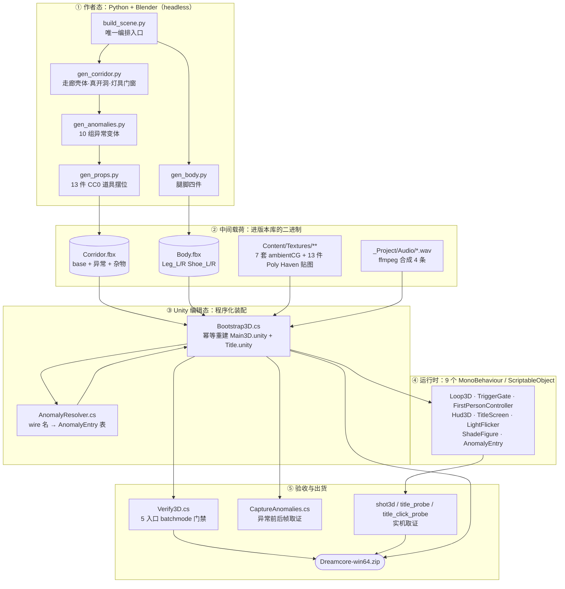
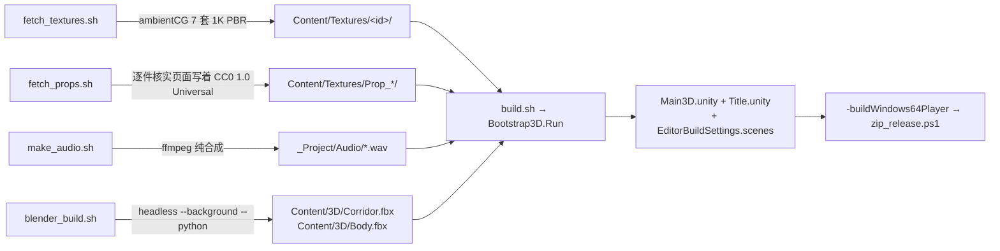
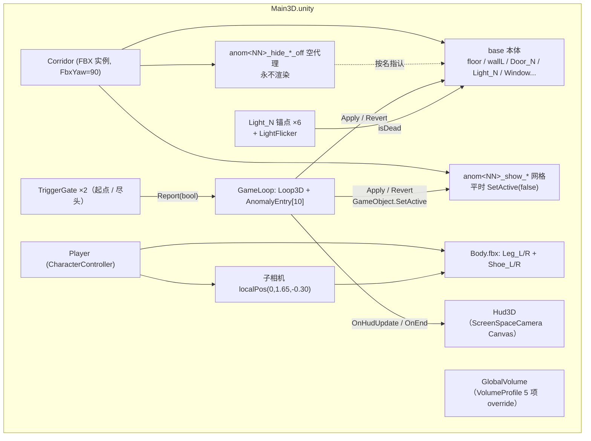
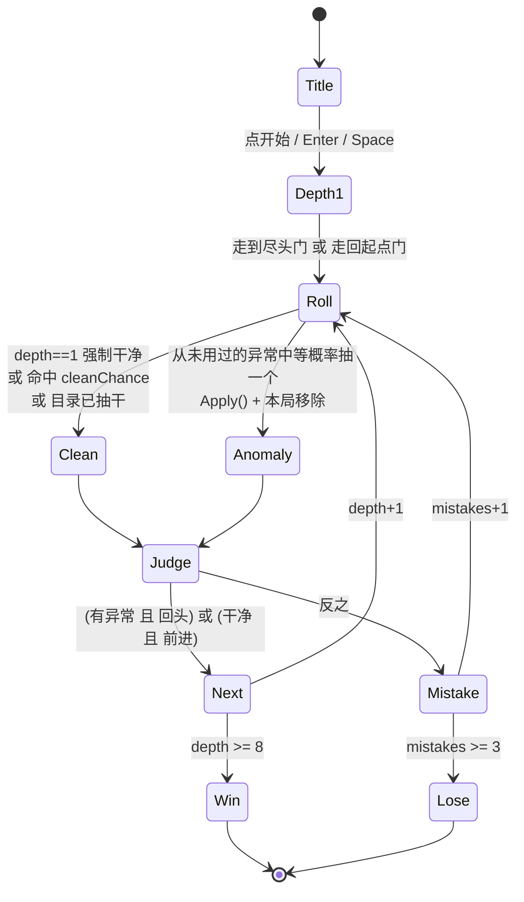

# 《昨日的明天》技术架构

> 8 小时单人 gamejam 作品。Unity 6.3 LTS + URP 17.0.1 + Blender 5.2.2。
> 本文写的是**实际跑在仓库里的那套**，不是理想设计。凡是实测出来的口径都标了出处。

---

## 0. 三十秒版

一条走廊、10 组异常、一个"觉得不对劲就回头"的判定循环。

- **走廊本体**由 Blender 侧的 Python 脚本程序化建模，headless 导出成两只 FBX；
- **异常分组**不靠层级、不靠集合、不靠元数据，只靠**物体名字的字符串语法**跨进程传递（下称 wire 契约）；
- **Unity 场景**不由美术手搭，而是编辑态 C# 脚本 `Bootstrap3D` 每次从 FBX + 贴图 + 音频**幂等重建**；
- **出货前**有三段 batchmode 门禁（`Verify3D`）+ 四支实机取证工装（真窗口、真按键、真截图）。

整个工程没有一处"手工拖出来的场景引用"，所以它可以被删掉重建、并且能被机器判定建对没有。这是 8 小时预算下唯一可行的纪律：**能重建的东西才敢改**。

---

## 1. 总览



五段里只有 ② 是"资产"，其余全是**代码**。这是本项目最重要的结构特征：美术产物被压到最小，可复现性优先。

---

## 2. 六条塑形约束

架构是被"不许做什么"逼出来的。这六条写在设计文档里，逐条解释了后面所有的样子：

| 约束 | 导致的架构后果 |
|---|---|
| **不新增任何 Unity 包** | 没有 Input System、没有 cinemachine、没有 test-framework。输入走 legacy `Input.GetAxis`；验收不能写单元测试，只能自建 batchmode 门禁 `Verify3D.cs`。`Packages/manifest.json` 实测只有 URP 17.0.1 + ugui 2.0.0 + 引擎自带 modules。 |
| **`.meta` 必须跟踪** | GUID 稳定，FBX 重建后场景引用不断链。 |
| **场景必须可幂等重建** | 场景文件是**产物**不是源文件。任何"在编辑器里手改一下"都会在下次 `build.sh` 被抹掉——这条纪律反过来逼出了"配置写进代码"的全部风格。 |
| **走廊是一条直线，无转角** | 24m 单走廊复用 + 异常变体集。玩家每次"下一层"看到的是同一条走廊，差异只来自异常。这让"找异常"成立，也让美术量恒定。 |
| **光照不烘焙、材质只用 URP Lit/Unlit** | 全靠实时点光 + 后处理。代价是暗部噪点，收益是异常态（灯灭）不需要重烘。 |
| **HUD 用 ScreenSpaceCamera** | Overlay 层的 UI 不进后处理链，梦核滤镜吃不到 HUD，文字会像贴在外面上、和走廊成两个世界。 |

**非目标**：多场景、骨骼动画、高模、存档、设置菜单、暂停菜单。

---

## 3. 资产产线：逐跳数据流



几个不显眼但会咬人的工程事实：

- **道具几何（`.fbx`）不进版本库**，暂存在 `${TMPDIR}/ph-props/`；进库的只有它的**贴图**。也就是说：仓库自足性能重建游戏，但第三方道具的原始网格要靠脚本重新联网取。
- **许可证证据在 `logs/`，而 `logs/` 被 gitignore**。逐件核实记录目前不在版本库里——README 里把出处链接补上了。
- **防陈旧日志三件套**：`rm -f 日志` + `touch marker` + `[ 日志 -nt marker ]`。batchmode 失败时常常仍写出旧日志，只看"文件存在"会读到上一轮的绿。
- **`--python-exit-code 4` 必须写在 `--python` 之前**，否则 Blender headless 里 Python 抛异常仍然 rc=0，`|| exit 1` 那道门是废的。

---

## 4. 跨进程契约：前缀式 wire 名

这是全项目**唯一**的跨进程接口，也是花掉最多预算去实测的地方。

### 4.1 语法

```
^anom(\d{2})_(show|hide)_(.+)$
```

| 形态 | 含义 | 例 |
|---|---|---|
| `floor` / `wallL` / `Door_3` / `Light_2` | base 恒定本体，**裸名** | — |
| `anom<NN>_show_<leaf>` | 该异常激活时**出现**的网格 | `anom02_show_shadeFigure` |
| `anom<NN>_hide_<base目标名>_off` | 该异常激活时**消失**；物件本身是个空物体指认代理 | `anom01_hide_Light_2_off` → 指认 `Light_2` |
| `Prop_<slug>[__<n>]` | 第三方道具实例，slug 内**禁下划线**（按 `IndexOf("__")` 切实例号） | `Prop_chair__2` |

代理物件自己永不参与渲染，只负责"指认谁该消失"。`_off` 后缀的存在是因为 Blender 对象名全局唯一——同名代理会被自动改名 `.001`，必须给个不同的字面名。

### 4.2 为什么是这个形态（不是集合、不是 Empty 包裹）

两条实测证伪，代价极高，别重新推导：

1. **Blender 集合完全不进 FBX。** 对导出产物严格 grep 集合名 = 0 命中；Blender 5.2.2 的 43 个 `export_scene.fbx` 参数里没有"集合导出为节点"开关（`object_types` 只认对象）。→ 想跨进程传分组信息，**只剩物体名这一条通道**。
2. **Empty 包裹方案被拒。** 用空物体给每组异常包一层，层级路径确实保住了，但它会连带把子节点的 `localPosition` 一起除/乘，把 100× 缩放搬到父级上——几何位置就错了。

所以：集合只是**作者态的组织手段**，从不进 FBX；分组语义被序列化进**名字字符串**。

### 4.3 唯一真相

命名约定只有 `AnomalyResolver.cs` 一个文件知道。发送侧（`gen_*.py`、`build_scene.py` 的导出前自检）、消费侧（`Bootstrap3D`、`Verify3D`、`CaptureAnomalies`）一律调 `AnomalyResolver.IsAnomalyWireName()`，**不各自复制正则**。这条纪律让"改契约"是一次改动而不是六处。

### 4.4 配套口径：FBX 里只有世界量是米

同一条通道还把 FBX 节点 baked 成 `lossyScale = 100` + 顶点预除 100（与有没有 Empty 包裹无关，资产根读 1）。因此：

> **只有 `Renderer.bounds` / `Collider.bounds` 是米。**
> `Transform.localScale`（读 100）、`Mesh.bounds`、`BoxCollider.size`、`Collider.center`、缩放下祖先的 `localPosition` 都**不是**。

所有几何尺寸断言必须走 `bounds`。另外 Blender +Z 落到 Unity +Y（每个网格节点带 `worldRot≈(270,0,0)`，根不转），所以装配时统一套一个 `FbxYaw = 90f`（`Bootstrap3D.cs:44`）。立方体的 AABB 对旋转不变，会**掩盖**这条事实——非对称网格必须用 `renderer.bounds` 复核。

---

## 5. 运行时拓扑



职责表（9 个运行时脚本，共约 500 行）：

| 脚本 | 行 | 单一职责 | 关键设计点 |
|---|---|---|---|
| `Loop3D` | 116 | 目录驱动的异常抽取 + 层级判定 + 结局 | 见 §6，**顺序写死勿调** |
| `AnomalyEntry` | 57 | 一个异常 = 两组 GameObject 的开合 | `Apply`/`Revert` 必须逐字互逆；不关心物件是灯还是墙 |
| `AnomalyResolver` | 148 | wire 名 → 异常表 | 全树递归扫名，不依赖任何中间节点；解析失败**打警告后丢弃，不静默、不抛异常** |
| `FirstPersonController` | 116 | 移动/视角/脚步/腿 | 步频**按位移推进**不按时间；腿与脚步声共用同一相位源 |
| `Hud3D` | 69 | 显示 + 开局引导条 | 引导只播一次，淡完 `SetActive(false)`（Text 每帧重建网格） |
| `TitleScreen` | 48 | 标题页 | `onClick` 监听**必须运行期挂**，不进场景序列化 |
| `LightFlicker` | 43 | 灯闪 / 死灯余辉 | `isDead` 时留 0.04 余辉而不是 0 |
| `ShadeFigure` | 38 | 黑影 billboard | 只做朝向，**绝不去禁用自家 MeshRenderer** |
| `TriggerGate` | 25 | 两端判定门 | `OnTriggerEnter` → `loop.Report(isForwardGate)` |

两处容易看漏的开关语义冲突，都是实机才暴露的：

- `ShadeFigure` 的显隐权属于 `AnomalyEntry`（`GameObject.SetActive`）。组件级 `enabled` 与物体级 `SetActive` 是两套开关，混用会让黑影异常**永久不可见**。
- `FirstPersonController.Start()` 一进来就锁光标，所以 `Update` 里必须有 `Escape → Application.Quit`；没有暂停菜单的玩家否则只能 Alt+F4。标题页正相反——`TitleScreen.Start()` 必须**解锁**光标，否则点不到按钮，玩家会以为界面死了。

---

## 6. 玩法状态机



判定规则一句话：**有异常时回头为对，干净时前进为对。**

三段"顺序写死勿调"的设计（`Loop3D.cs` 头部注释）：

1. `depth == 1` **强制干净**——先给玩家"正常长什么样"的记忆锚，否则找异常不成立；
2. 干净判定**先于**抽样——先掷 `cleanChance` 决定这层是不是干净层；
3. 抽中即从 `unused` 移除——**本局不重复**。

这三段是从一个真 bug 里长出来的：最早的实现是运行时 `Random.value < 0.55` 掷骰子加随机亮黑影，玩家从没见过"正常"，所以"找异常"这个玩法根本不成立。那是**结构缺陷**，不是美术缺口。

数值口径：`maxDepth = 8`、`maxMistakes = 3`、`cleanChance = 0.35`、异常 10 组（`AnomalyTitles.Table` 逐条给中文标题）。一局约 3–5 分钟。

---

## 7. 装配阶段：Bootstrap3D

`Run()` = `CreateScene()` → `CreateTitleScene()` → `SaveAssets` + `Refresh`。场景文件是产物。

`CreateScene()` 内部是**严格有序**的（`Bootstrap3D.cs:72-177`），顺序即依赖：

```mermaid
flowchart LR
  P1["RenderSettings"] --> P2["Instantiate(Corridor.fbx)<br/>套 FbxYaw=90"] --> P3["PaintShell<br/>材质 + base 补 BoxCollider"] --> P4["AdoptLights"] --> P5["AttachBillboards"] --> P6["MakeGate ×2"] --> P7["Player<br/>CC + FPC + 相机"] --> P8["AssembleBody<br/>腿脚挂 Player 根"] --> P9["GlobalVolume"] --> P10["AmbientAudio"] --> P11["GameLoop<br/>Resolve + SettleToNormal"] --> P12["CreateHud"] --> P13["EventSystem"]
```



三条硬依赖与三条幂等手段：

- **`PaintShell` 给 base 补碰撞体，wire 件绝不补**——异常网格平时是关闭的，给它加 Collider 会让玩家撞到一堵看不见也摸不着的墙。
- **`AdoptLights` 在 FBX 自带的 `Light_N` 锚点上 `AddComponent`，不新建子 GameObject**——新建子物体会继承那条 100× 缩放链。
- **`AssembleBody` 必须在 Player 与相机之后**（腿要挂到 Player 根、与相机同级，且要拿相机引用算垂角）；**`Resolve` 必须在 FBX 实例化进同一棵树之后**。
- 幂等 ①：每次 `NewScene(EmptyScene, Single)` 全量重建后存回**固定路径**，不存在"越跑越多份"。
- 幂等 ②：材质靠 tile 签名 `Dictionary` 去重（`:87`），同一贴图同一 shader 只建一个材质。
- 幂等 ③：`EnsureDreamcoreProfile` 先 `components.RemoveAll(c => c == null)` 清掉旧的 `fileID: 0`（`:615`），再走 `GetOrAddOverride<T>`（`TryGet` 命中即复用，`:650`）。注释里明写着"不判重就会每跑一次多存一份同名子资产"。

### 两个 URP 资产陷阱（同族坑，已规避，改模板时勿回退）

- **`UniversalRenderPipelineAsset.Create()` 不带参**时，默认 Renderer Data 只活在内存里，存盘后引用丢失 → 构建期 shader 剥离循环刷 "Default Renderer is missing"，实测日志暴涨 **64.7GB 并卡死构建**。本模板改成"先建独立 renderer 资产，再 `Create(rd)`"。
- **`VolumeProfile.Add<T>()` 只 `CreateInstance` + 塞列表**，不做 `AssetDatabase.AddObjectToAsset`，存出来的资产是 `components: [{fileID: 0} ×5]`——**编辑器里看着有 override，构建产物里全是 null**。梦核滤镜（Bloom / Vignette / FilmGrain / ColorAdjustments / ChromaticAberration 共 5 项）必须走 `GetOrAddOverride`，门在 `Verify3D` 的"5 道 override + 强度 > 0"。

---

## 8. 验收体系：Verify3D

没有 test-framework 包（§2 硬约束），所以验收是一整套自建的 batchmode 门禁。5 个入口，按**验证对象**分工，不是按"重要程度"：

| 入口 | 位置 | 验什么 | 归属环节 |
|---|---|---|---|
| `ProbeHierarchy` | `:181` | M0 层级/命名保真探针（手写 failures，不用 Assert） | 契约选型期 |
| `VerifyResolveProbe` | `:356` | wire 解析器端到端（含解析失败分支） | 契约层 |
| `VerifyGameplay` | `:553` | 玩法状态机：抽取顺序、判定表、结局边界 | **不引用任何资产**，M1 灰盒期即成立 |
| `VerifyAssembly` | `:710` | 读 `Main3D.unity`：装配完整性（含 M8 五道标题/引导门） | 装配段 |
| `VerifyFbx` | `:1352` | 只验 `Corridor.fbx`：几何、开洞、杂物、命名保真 | 建模段（`blender_build.sh` 单独跑它） |

三段 batchmode 门禁 = **建模段（Fbx）→ 装配段（Assembly）→ 玩法段（Gameplay）**，`tools/unity_verify.sh` 依次跑。

### 8.1 判据形状四类

1. **计数等值**——一律从名单派生：`CorridorBaseNames`(71) / `PropBaseNames`(15) / `BaseEmptyNames`(6) / `AnomShowNames`(9) / `AnomHideNames`(22) 的 `.Length`，**禁魔数**。加一个物件只需改名单，门自动跟上。
2. **缺席 / 越界计数 == 0**——例如 `_Proto_` 泄漏、跨中线、糊住门窗洞。
3. **世界量容差区间**——全部走 `bounds`（§4.4）。走廊实测口径 **宽 2.50m × 高 3.10m × 长 24.05m**（旧读数 2.91 作废，那是露在墙外的窗板撑出来的假宽度）。
4. **逐字名保真 + 材质/导入器状态断言**——`_NORMALMAP` 关键词、`textureType = NormalMap`。贴图门按 shader 分口径：**Lit 15 个 + Unlit 1 个**（`WindowBuildings` 窗板本来就无光照），任何"整体材质回退"会让 Lit 计数掉下 15 而报红。

### 8.2 坏期望注入：证明门有牙

自写的检查器如果不先被喂坏样本，就不知道它是不是恒绿。机制：

```csharp
static readonly bool BadSample = Environment.GetEnvironmentVariable("VERIFY_BAD") == "1";  // :29
static readonly float SizeLo = BadSample ? 90f : GoodSizeLo;                              // :37
```

`VERIFY_BAD=1` 把**期望值**翻成物理不可能的数（尺寸容差 0.9–1.1 → 90–110、哨兵计数 99、HUD 期望翻成 Overlay……），一次跑让每条分支各成一红、互不短路，红行自标 `BadTag` 便于对账。跑法：

```bash
./tools/unity_verify.sh                 # 绿跑：必须全绿
VERIFY_BAD=1 ./tools/unity_verify.sh    # 坏跑：必须逐条红
```

**一个真实教训**：通行带门原本写成 `PropBaseNames.Length` 与"通过件数"比较——那是个**恒等式**，永远绿。改成 99 哨兵后，绿跑 `narrow=0`、坏跑 `narrow=15`，门才有牙。"我写了个检查"和"检查会失败"是两件事。

---

## 9. 实机取证与量具局限

四支工装，各自证明的东西不同，**判据可靠性也不同**：

| 工装 | 证明什么 | 判据 |
|---|---|---|
| `CaptureAnomalies.cs` | 10 组异常前后**有几何/贴图/灯位差分** | 编辑态静态渲染 640×360，逐组 md5 必须 differs |
| `shot3d.ps1` | 出货包真窗口里移动/转向**真的改变了画面**、Esc 真退出 | 逐帧 md5 DIFFER + luma 阈值（00 < 01×0.5 才证明 00 是真暗的标题页） |
| `title_probe.ps1` | 标题页**不会自己前进** | 零输入连拍 t0/t6/t12/t24 |
| `title_click_probe.ps1` | 真鼠标点"开始"**真的开局** | `SendInput` 合成点击；before 帧 luma>45 直接 throw 拒判，after 需 >45 且 >before×2 |

护栏统一为：`GetForegroundWindow` 不符即 throw（防把按键打到别的窗口）、`finally` 无条件 Kill（防留僵尸进程）。

### 已登记的量具局限（诚实版，别当已解决）

- **帧哈希对"腿会不会摆"没有判据力**：FilmGrain 是时域噪声、6 盏灯在闪，任意两帧必然 DIFFER。腿只能靠肉眼帧 + `verify-asm.log` 的数字口径（眼睛 y=1.75、鞋在眼前方 0.350m / 垂角 77.6°）。
- **中心/四角亮度比不能当暗角证据**：实测比值 1.202 > 1，读数是暗端墙面和内容给的，不是滤镜给的。最终退回肉眼 + 前后帧对比。
- **md5 差分抓不到"本体摆对没有"**：信报箱门"悬空/被埋"那条缺陷正是它的盲区，只在实机暴露。
- **`CaptureAnomalies` 是编辑态静态渲染**：batchmode 进不了 Play Mode，`LightFlicker` 不闪、后处理是否求值不确定，所以它**不等于出货画面**。
- **`Input.GetAxis("Mouse Y")` 是平滑轴**（sensitivity 0.1）：一次 30px 的合成移动摊到每帧只有约 0.1°，读出来像"低头没反应"——那是**量具坏了**，不是玩家按不动。改成三段各 250px。
- **ESC 退出码 `0xC0000005` 不等于退出失败**：Mono + d3d12 关栈时的访问违例，且关栈要 9s 左右。真超时了去看 `player.log` 里有没有 `[Physics::Module] Cleanup current backend`。
- **mesh 节点的 `transform.position` 恒 (0,0,0)**，必须取 `bounds.center`。
- **共享桌面上的点击取证会被别的窗口抢焦点**：另一个会话/窗口的 Enter/Space 会落在前台窗口，被 `TitleScreen.Update` 当成"开局"，标题页在探针点击前就没了。探针因此内置 luma 拒判。

---

## 10. 素材与许可口径

**"零第三方资产"这句不成立，别照抄。** 准确口径：

| 类别 | 来源 | 许可 | 数量 |
|---|---|---|---|
| 走廊壳体 / 门窗 / 灯具 / 构件（含真开洞） | `blender/gen_corridor.py` 自建 | 自有 | — |
| 10 组异常变体 | `blender/gen_anomalies.py` 自建 | 自有 | 10 |
| 玩家身体（腿脚四件） | `blender/gen_body.py` 自建 | 自有 | 4 |
| 道具网格 | **Poly Haven** | **CC0 1.0 Universal** | 13 件资产 → 15 个摆放实例 |
| 墙面/地面 PBR 贴图 | **ambientCG** | CC0 | 7 套 1K |
| 道具随件贴图 | Poly Haven | CC0 | 13 套 |
| 音频 | `tools/make_audio.sh` ffmpeg 程序合成 | 自有 | 4 条 |

CC0 1.0 无署名义务、可商用。道具逐件核实方式：抓 `https://polyhaven.com/a/<id>` 页面字符串 `"CC0 1.0 Universal"`，命中数 <1 直接跳过并判红（Poly Haven 的 `attribution` API 端点 404，只能抓页面）。出处清单：`dreamcore/Assets/Content/Textures/CREDITS.md` 与 `PROPS_CREDITS.md`。

红线口径：**仅 CC0，CC-BY 不接受**（省掉署名链路与合规风险）。

---

## 11. 化石坑（为什么有些地方"看起来绕"）

这些决定单看代码会觉得多余，每条背后是一次实测代价：

1. **`AnomalyResolver` 全树递归扫名**，而不是找 `anom/show/hide` 中间节点——因为 FBX 层级任意嵌套且那些节点**不保证存在**（集合不进 FBX）。
2. **`hide` 用空代理指认，而不是直接给 base 物件改名**——base 名必须逐字保真，它是"正常态"的一部分，也是尺寸门的锚。
3. **`SwingLeg` 的旋转轴用父级空间现算**（`leg.parent.InverseTransformDirection(transform.right)`），而不是读腿节点的局部轴——Body 那棵树带着 `FbxYaw` 和导入器的轴向翻转，局部轴不可读；世界右向经父级反变换后是常量，玩家 yaw 在分子分母同时出现正好抵消。
4. **`stride` 累计不清零**，步序号 = `floor(stride/stepDistance)`——按位移而不是时间推进，慢走节奏下步频才不飘；落地才计数，下落过程中的水平位移不算步。
5. **`legBlend` 阻尼回 0**——不按停走阻尼的话，站着不动腿会僵在半路的弧度上。
6. **标题页是独立场景 `Title.unity`**，而不是往 `Main3D` 盖一个面板——构建场景表 `[Title, Main3D]`，Title 必须 index 0 才是启动场景；独立场景也让光标锁定/解锁的边界干净。
7. **`AnomalyResolver` 解析失败打警告后丢弃而不抛异常**——装配段抛异常会让 batchmode 整个失败、日志里分不清是哪一条 wire 坏了；丢弃 + 警告 + 门禁计数（§8.1 第 2 类）三段配合才既不断链又不静默。

---

## 附：怎么跑

```bash
./tools/blender_build.sh    # 改过 blender/*.py 才需要：headless 重导两只 FBX + wire 自检
./tools/fetch_textures.sh   # 缺 ambientCG 贴图时
./tools/fetch_props.sh      # 缺 Poly Haven 道具贴图时（逐件核 CC0）
./tools/make_audio.sh       # 缺音频时
./tools/build.sh            # Bootstrap3D 重建场景 → 构建 win64 → zip
./tools/unity_verify.sh                       # 三段门禁绿跑
VERIFY_BAD=1 ./tools/unity_verify.sh          # 坏期望注入，必须逐条红
powershell -File tools/shot3d.ps1 -Exe builds\win64-3d\Dreamcore.exe -OutDir logs\shots
```

详见 [`../tools/SUBMIT_CHECKLIST.md`](../tools/SUBMIT_CHECKLIST.md)。
